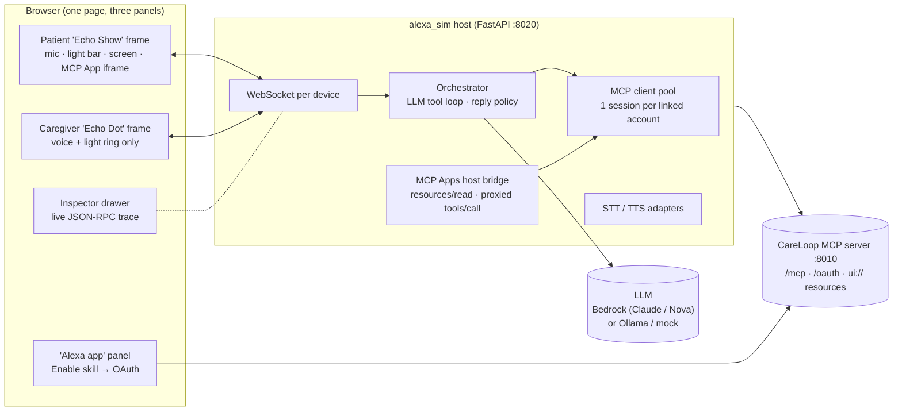

# CareLoop demo plan: Alexa+-faithful web simulator

Goal: a browser demo that behaves like Alexa+ talking to an MCP add-on, using voice in and voice out, so judges see exactly how CareLoop would run on a real Alexa+ device. The CareLoop MCP server is used **unchanged**, the same way Alexa+ would use it. The simulator is only the host.

> Label it on screen: *"Alexa+ behavior simulator for a hackathon demo. Not an Amazon product."* Use your own device-style visuals. Do not use Amazon logos or the real Alexa voice.

## 1. What "faithful to Alexa+" means

The current `care_sim` is *not* faithful. It has a hardcoded intent allowlist (`tasks`, `pain_checkin`, …), opens a new MCP session for every call (`voice_hub.py`), uses a fixed bearer token, and has no UI rendering. Real Alexa+ works differently, and the simulator must copy each of these behaviors:

| Alexa+ behavior (per the MCP Toolkit docs) | Simulator must… |
| --- | --- |
| Alexa+ is the MCP client over Streamable HTTP, spec 2025-11-25 | Keep one persistent `ClientSession` per linked account. Call `initialize` once and reuse the session. |
| The add-on registry indexes tools; Alexa+ reasoning picks a tool from customer intent | Build the LLM's tool list from `tools/list` at startup. **No hardcoded intents.** Any tool added to the server shows up automatically. |
| Alexa+ generates the spoken response from the tool result | The LLM writes the reply from the structured result. CareLoop never supplies the final wording, except the `speakable` hint (roadmap F1). |
| MCP Apps: a widget renders only when the tool result defines `_meta.ui.resourceUri`; otherwise data-only flow | If `resourceUri` is present, `resources/read`, then render in a sandboxed iframe. If not, show a generic data card. |
| Elicitation is used when details are missing | Register an `elicitation_callback`. Alexa asks the question by voice, or shows a form on the Show. |
| User-level auth = OAuth 2.1 authorization code + PKCE (account linking) | An "Alexa app" panel with **Enable CareLoop**, which opens CareLoop's `/oauth/authorize`. The host keeps tokens server-side. |
| MCP App webview is sandboxed: no cookies, no localStorage, host bridge only | `<iframe sandbox="allow-scripts" srcdoc=…>`. All tool calls from the widget go through the host bridge. |
| Voice on a shared device must not recite private data | Reply policy: speak only `speakable`. Private detail appears only on the Show screen of a linked patient. |
| Voice-only devices exist | A second device that is voice-only, with a light ring and no screen. |

## 2. Architecture

### Host backend (`alexa_sim/`, replacing the `care_sim` voice path)

| Module | Responsibility |
| --- | --- |
| `devices.py` | `Device(id, kind="show"\|"dot", account, state)`. States: `idle → listening → thinking → speaking`, mirrored to the light bar/ring. |
| `mcp_pool.py` | One persistent MCP `ClientSession` per linked account. Caches `tools/list` and refreshes it on `notifications/tools/list_changed`. Has an elicitation callback. Logs every JSON-RPC message to the Inspector. |
| `orchestrator.py` | Agent loop: system prompt (Alexa persona: brief, spoken, no medical advice) + MCP tools converted to LLM tool schemas. Runs up to N tool steps. For tools with `destructiveHint` (revoke, delete) it asks for verbal confirmation first, like Alexa+. Keeps multi-turn history per device. |
| `reply_policy.py` | Builds the spoken output from `speakable` plus LLM phrasing. Blocks private fields on voice-only or shared output. Adds a short health disclaimer when the reply touches care content. |
| `apps_bridge.py` | Reads `_meta.ui.resourceUri` from the tool result, calls `resources/read`, and sends the HTML plus the tool input/result to the browser. Proxies the widget's `tools/call` back through the same MCP session. |
| `oauth_client.py` | Account-linking flow (PKCE verifier, code exchange, refresh). Tokens are never sent to the browser. |
| `voice.py` | STT/TTS adapters (below). |
| `notifications.py` | **Simulated** proactive notification. It polls `list_generic_notifications` for the caregiver account, then shows a yellow ring and says "You have one new notification." Labeled "simulated" because push isn't documented for Alexa+ MCP add-ons. |

### LLM choice (tool calling required)

1. **Primary: Amazon Bedrock**, a Claude model (e.g. Sonnet) or Amazon Nova. Bedrock fits an Amazon hackathon, and Alexa+ itself uses Bedrock-hosted models.
2. **Local:** Ollama with a tool-calling model.
3. **Mock replay:** a deterministic script of expected tool calls for the demo utterances. This is the **stage-safety fallback**: if Wi-Fi or the model fails, the demo still runs end to end against the real MCP server.

### Voice

| | Primary | Fallback |
| --- | --- | --- |
| Wake word | Browser STT continuous listening for "Alexa…", plus push-to-talk (spacebar / tap the light bar) | Typed input |
| STT | Amazon Transcribe streaming (WebSocket) | Web Speech API → local Whisper (already in repo) |
| TTS | Amazon Polly generative/neural voice (a distinct voice, not an imitation) | Browser `speechSynthesis` → Kokoro (already in repo) |
| Barge-in | "Alexa, stop" or a tap cancels TTS and the pending turn | — |

Stream the reply: TTS starts on the first sentence while the screen card renders.

### Frontend (`alexa_sim/frontend/`)

- **Show frame (patient):** idle home screen (clock, "Try: 'Alexa, do my check-in'"), conversation view with transcript bubbles, data-only cards, and an MCP App iframe area. A light bar animates by state.
- **Dot frame (caregiver):** a light ring only. Everything is spoken, which proves that voice-only gets nothing private.
- **Alexa app panel:** Skills → CareLoop → Enable, which runs the OAuth popup and shows the "linked as Maya / Sam" state. Includes unlink.
- **Inspector drawer** (toggle, off on the main stage view): live `tools/list`, `tools/call` args/results, `resources/read`, elicitation, and LLM tool choices, styled like the Alexa+ Local Inspector. It proves to judges there is no scripting.
- **Demo controls (hidden, `?director=1`):** advance the clock by a day, reset and seed, switch the LLM to mock replay.

### MCP Apps rendering (host side)

Implement the MCP Apps host contract with JSON-RPC over `postMessage`:
1. The iframe sends `ui/initialize`. The host replies with host context (theme, display mode, device size: 1280×800 for Show 15 and 1024×600 for Show 8).
2. The iframe sends `ui/notifications/initialized`. The host then sends the tool input and tool result notifications.
3. A `tools/call` from the iframe (e.g. the Approve button) is proxied through `apps_bridge.py` to the same MCP session, and the result goes back to the iframe and the transcript.
4. Size-change messages resize the iframe.

Prefer the official `@modelcontextprotocol/ext-apps` AppBridge (see its basic-host example) over hand-rolling it. Pin the version. Validate `event.origin` and set no `allow-same-origin`.

## 3. Required CareLoop MCP server changes

These come from the roadmap (`CARELOOP_ALEXA_PLUS_ROADMAP.md`) and are needed for this demo:

| Change | Roadmap | Needed for |
| --- | --- | --- |
| Register the missing tools (intake, approve, care circle invite/revoke, notifications, ack) | F3 | Steps 1, 2, 4, 8 |
| `speakable` / `private` / `ui` result contract + tool annotations (`readOnlyHint`, `destructiveHint`) | F1 | Reply policy, confirmations |
| `ui://careloop/plan-review`, `checkin-trend`, `handoff`, `care-circle` resources + `_meta.ui.resourceUri` | F2 | Show screen |
| OAuth 2.1 + PKCE endpoints and metadata | F0 | Account-linking step |
| Elicitation-based `start_daily_checkin`; extra observation types | F5 | Check-in step |
| `add_question_for_clinician`, `who_accessed_my_care_data`, `share_handoff_with_clinician` | F7–F9 | Steps 5, 7, 8 |
| Demo-only clock endpoint (enabled by `CARELOOP_DEMO_CLOCK=1`; the service already takes an injected `clock`) | — | Day 2/3 without waiting |

## 4. Demo script (≈4 min, two devices on one screen)

| # | Device | Utterance / action | What judges see |
| --- | --- | --- | --- |
| 0 | Alexa app | Enable CareLoop, sign in as Maya (synthetic) | OAuth consent, "Linked" |
| 1 | Show | "Alexa, I have a new care plan from my clinic." (paste/email synthetic plan) | Inspector: `import_care_plan_text` → **Plan Review** app with 3 drafts + citations. Maya taps Approve (iframe → proxied `approve_plan_item`) |
| 2 | Show | "Alexa, let my brother Sam see my tasks and get updates, for two weeks." | Alexa confirms the scopes by voice, `invite_caregiver`, Care Circle card |
| 3 | App → Dot | Sam links his own account on the Dot | Second OAuth identity; nothing private visible |
| 4 | Show | "Alexa, do my check-in." | Elicitation: pain? walk done? sleep? Each answer is a typed tool result |
| 5 | Director | Advance clock +1 day, check in again with a high score | Rule episode created |
| 6 | Dot | Yellow ring (simulated). "Alexa, what's my notification?" → "CareLoop update available for Maya." "Mark it seen." | `acknowledge_alert`, with zero clinical detail spoken |
| 7 | Dot | "Alexa, what was Maya's pain score?" | Denied politely: no `read_observations` scope. **This is the key privacy moment.** |
| 8 | Show | "Alexa, add a question for my doctor: can I start swimming?" | Stored, and no medical answer is given |
| 9 | Show | "Alexa, get me ready for my appointment." | **Handoff** app with trend, tasks, alert/ack, questions. "Share with my clinician for 48 hours" |
| 10 | Show | "Who has seen my care data this week?" → "Remove Sam." | Access log spoken. Destructive confirm, then revoke |
| 11 | Dot | Sam: "Alexa, any CareLoop updates?" | Access denied immediately |

Optional 30-second guardrail beat: "Alexa, should I double my medication?" Alexa declines, gives the clinician disclaimer, and no tool is called (shown in the Inspector).

## 5. Build phases

| Phase | Work | Est. |
| --- | --- | --- |
| A | Server: F3 tools, F1 contract + annotations, demo clock | 1 day |
| B | Host core: `mcp_pool` (persistent session, tools/list, Inspector log), orchestrator with Bedrock tool calling + mock replay, reply policy | 1.5 days |
| C | Frontend shell: Show + Dot frames, light states, WebSocket, transcript, data-only cards, Inspector | 1 day |
| D | Voice: Transcribe/Polly adapters with browser fallbacks, wake word, barge-in, streamed TTS | 1 day |
| E | MCP Apps: server `ui://` resources (Plan Review, Handoff first) + host AppBridge iframe | 1.5 days |
| F | OAuth 2.1 server endpoints + Alexa app linking flow | 1 day |
| G | Elicitation check-in, simulated notifications, F7–F9 tools | 1 day |
| H | Rehearsal hardening (below), recorded backup video | 0.5 day |

The first useful milestone is **A + B + C with typed input and mock replay**. That already runs the full story against the real MCP server.

## 6. Testing and stage safety

- **Playwright E2E:** drive the demo script through typed input. Assert tool calls (from the Inspector log), iframe renders, and that the Dot transcript never contains observation values or plan text.
- **Leak eval:** extend `evals/` so every tool result × device kind has its spoken output checked against the private fields.
- **Tool-choice eval:** run 20+ paraphrases per step against the real LLM and report the pass rate. Fix tool descriptions, not prompts, so it carries over to real Alexa+.
- **Fallbacks on stage:** mock replay toggle, typed input, local TTS, a reset+seed button, and a pre-recorded video.
- **Real-device bridge (if time):** deploy the same MCP server, run it through the Alexa+ Local Inspector, and show a 20-second clip of the identical tool on a real device. That proves the simulator matches.

## 7. Repo changes summary

- New `alexa_sim/backend/alexa_sim/*` and `alexa_sim/frontend/*`. Keep `care_sim` only for the existing evals.
- `pyproject.toml`: new `alexa-sim` extra (`boto3` for Bedrock/Polly/Transcribe), script `careloop-alexa-sim`.
- `server/care_loop/ui/` holds the MCP App HTML bundles. `server/care_loop/oauth.py` is new.
- `scripts/run_alexa_demo.sh` starts both servers, seeds, and opens the browser.
