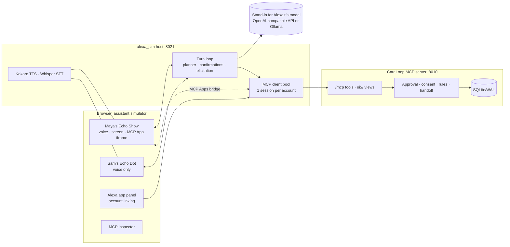

# Architecture

How CareLoop is built: the components, the MCP tools and their result contract, how a document becomes cited plan items, and where the code lives.

| | |
| --- | --- |
| Protocol | MCP 2025-11-25 over Streamable HTTP at `/mcp`; MCP Apps views (`ui://careloop/*`); MCP elicitation. Discovery, tool listing and tool calls also work under 2026-07-28; elicitation tools do not yet ([friction log F-28](FRICTION_LOG.md)) |
| Server | Python, FastAPI, official MCP Python SDK, SQLite/WAL |
| Assistant simulator | Echo Show-style and Echo Dot-style devices, simulated Alexa app account linking, live MCP inspector |
| Voice | Local Kokoro TTS and Whisper STT on any system (MLX Whisper on Apple Silicon, faster-whisper on Windows, Linux and Intel Macs), with browser speech fallback |
| Planner | In production, Alexa+'s own model chooses the tools. The simulator stands in with any OpenAI-compatible API, a local Ollama model, or a deterministic mock for stage safety |
| Identity | Credential-derived patient/caregiver identities; no caller-supplied patient scope |
| Privacy | Voice-safe tool results, patient-owned expiring grants, generic caregiver notifications, deletion and purge |
| Document intake | Prescription/plan upload: PDF text first, PaddleOCR fallback, local LLM proposes items, deterministic checks, patient approves each item |
| Tests | 410 tests, including live end-to-end runs against a real server; an intake eval against the configured model |

## Components



The simulator does what Alexa+ does for an MCP add-on:

- It discovers tools with `tools/list` and lets the model choose among them.
- It speaks only the `speakable` field.
- It renders the view declared on the tool definition in a sandboxed iframe.
- It answers elicitations by voice.
- It confirms destructive actions before running them.

The caregiver's ring is a **simulated push** (the host polls generic notifications), because Alexa+ MCP add-ons have no documented server push.

## MCP surface

Endpoint `http://127.0.0.1:8010/mcp` (Streamable HTTP, bearer token required). `GET /healthz` is public.

| Tool | Purpose |
| --- | --- |
| `import_care_plan_text` / `approve_plan_item` | Import synthetic plan text into source-cited drafts, then explicitly activate an item |
| `list_care_tasks` / `record_task_completion` | List plan items (counts + refs) and record completions |
| `get_care_plan_source` | Open a reviewed source excerpt in the private view |
| `start_daily_checkin` | Check-in that asks its own follow-up question via **MCP elicitation** |
| `record_pain_observation` / `correct_pain_observation` | Record a validated, idempotent 0–10 value; corrections keep history |
| `search_care_history` / `list_care_records` | Authorized, source-linked history (ISO dates or `last_N_days`) |
| `list_care_circle` / `invite_caregiver` / `accept_caregiver_invitation` / `revoke_caregiver` | Patient-controlled caregiver access (invitations can carry a name, e.g. "Sam") |
| `assign_task` / `list_my_assigned_tasks` | Assign a task to a family member with `perform_tasks`; they list and complete their own tasks. Results carry `reminders` for Alexa+ to create natively |
| `add_question_for_clinician` | Save a question for the next handoff; CareLoop never answers it |
| `review_plan_by_voice` | Guided, resumable review of draft items by voice (MCP elicitation per item); medicine and flagged items stay on screen |
| `update_task_time` | Move a task to a new spoken time ("8 pm", "9"), by name or id |
| `accept_data_use` | The patient accepts the one-time data-use disclosure; voice tools ask for it before first use |
| `set_my_details` | The patient's spoken name (used in family members' messages), time zone, and whether suggestions are on |
| `start_teach_back` | **Patient only.** Asks the patient to say back key plan values through elicitation and checks each answer in code; keeps only the structured value heard. Pauses on "stop" and resumes later |
| `get_suggestions` | **Patient only.** Up to three things worth raising now, each with an offer a "yes" can run (for example the visit handoff). Computed from approved records; never about symptoms |
| `who_accessed_my_care_data` | Who else viewed or acted on the patient's data (default: last 7 days) |
| `list_generic_notifications` / `acknowledge_alert` | Generic caregiver updates and new-task notices, as counts only ("You have 1 new task from Maya."). No alert detail and no task name; "mark it seen" clears them |
| `create_visit_handoff` | Date-bounded, cited handoff (ISO dates, epochs, or `last_7_days`) |
| `export_care_data` / `delete_care_record` | Patient data rights |
| `get_intake_status` | Status of the latest uploaded document: reading, ready with counts, or unreadable |
| `review_plan_item` | **App-only**: approve, edit the spoken name or times, or reject a draft on the patient's screen |
| `get_private_view` | **App-only** (`_meta.ui.visibility: ["app"]`): detail for MCP Apps views; hidden from the model |

**Voice-safe result contract.** Every model-visible tool returns structured content with these fields:

- `status`
- `speakable`: counts and statuses only, safe for a shared speaker
- `surface`
- `view`
- `refs`: opaque ids with position-based labels such as `draft task 1`

Failures are MCP tool errors with generic text. Each tool declares its MCP Apps view in `_meta.ui.resourceUri`. Those `ui://careloop/<view>` resources are static HTML shells that do the MCP Apps handshake and load detail only through `get_private_view`, which runs the same identity and consent checks. Destructive tools carry `destructiveHint` so hosts confirm first. Tool arguments never select another patient.

## Document intake

Patients, or family members the patient grants `upload_documents`, upload a prescription or discharge plan in the private view (`POST /api/care/documents/upload`) or through the simulator's Alexa app panel. Alexa+ doesn't pass user files to add-ons, so uploads never go through voice.

1. **PDF text layer** (`pypdf`) per page; a quality check sends empty or garbled pages to OCR.
2. **OCR fallback** (`PaddleOCR`, pages rendered with `pypdfium2`) for scanned pages and photos; each line keeps its confidence.
3. **LLM** (local Ollama by default, `gemma4:e4b`; or any OpenAI-compatible endpoint, see `CARELOOP_INTAKE_LLM`) receives numbered lines (`p1:L12`) fenced as data and returns schema-constrained JSON items that cite their lines.
4. **Deterministic checks:**
   - Citations must exist and the instruction must appear verbatim.
   - **Every number must appear in the source.**
   - Schedules come from a fixed frequency table.
   - Alert rules are accepted only in the supported form, with their numbers taken from the text.
   - Low-confidence OCR, conflicts and unused lines are surfaced.
   - Failures become **needs review**, never silently dropped.
   - If the model is unavailable, a pattern fallback runs and flags every item.
5. **Patient review** on screen: approve, edit the spoken name or times, or reject. Medicine and flagged items cannot be approved by voice. Raw extracted text expires after 24 h.

```bash
uv run python evals/intake/run_intake.py --model gemma4:e4b --repeat 3
```

On the synthetic set (typed, scanned, photo, injection), 3 runs each: recall 100%, invented numbers 0, citations valid, injection never followed. Median time per document: 8 s typed, 28 s photo, 41 s scanned (CPU OCR).

## Repository layout

```text
server/care_loop/        CareLoop MCP server: tools, MCP Apps views, auth, core rules
  extraction/            PDF text layer + PaddleOCR fallback → numbered source lines
  structuring/           local-LLM schema, prompt, deterministic checks, pattern fallback
  tools/records.py       MCP tools and the voice-safe result contract
  ui/                    ui://careloop views (static MCP App shell)
alexa_sim/               the one simulator folder: Alexa+ behavior simulator and scripted evaluator
  backend/alexa_sim/     host: MCP client pool, turn loop, planners, voice engines, MCP Apps bridge
    evaluator/           scripted, deterministic eval harness used by evals/run_careloop.py
  frontend/              devices, Alexa app panel, inspector, speech capture
  tests/                 simulator and evaluator tests
evals/                   standalone eval cases; evals/intake/ synthetic documents + intake eval
samples/                 synthetic prescription PDF, scan, photo and prompt-injection documents
scripts/                 run, seed, and end-to-end scripts
docs/                    setup, configuration, architecture, security, features, demo guides, evals, friction log
```

Key documents:

- [Friction log](FRICTION_LOG.md)
- [Evals](CARELOOP_EVALS.md)
- [Driving the simulator end to end](CARELOOP_SIMULATOR_WALKTHROUGH.md)
- [UI guide](CARELOOP_UI_GUIDE.md)
