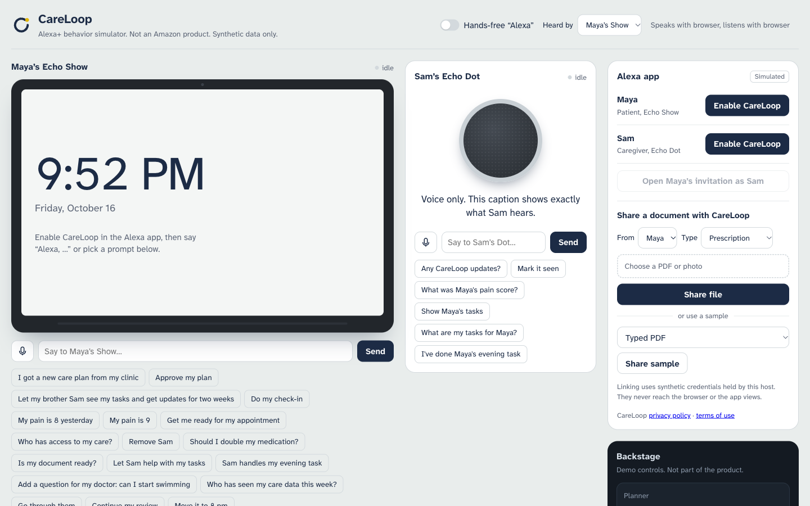
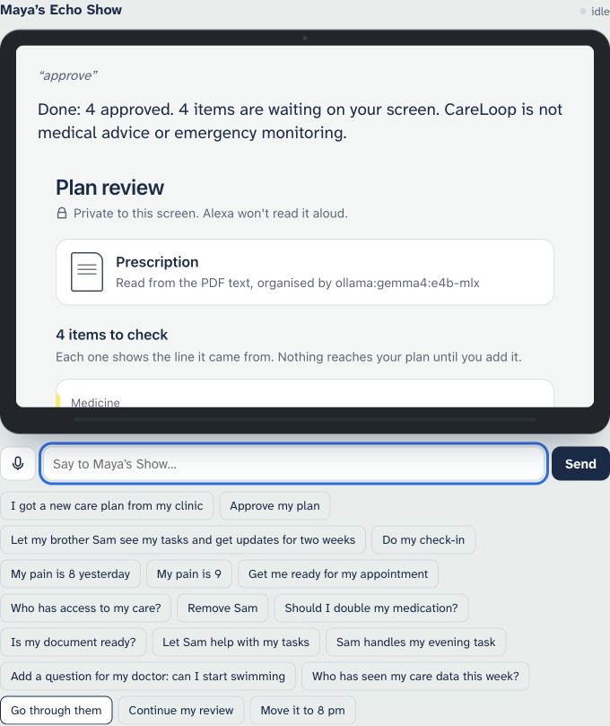
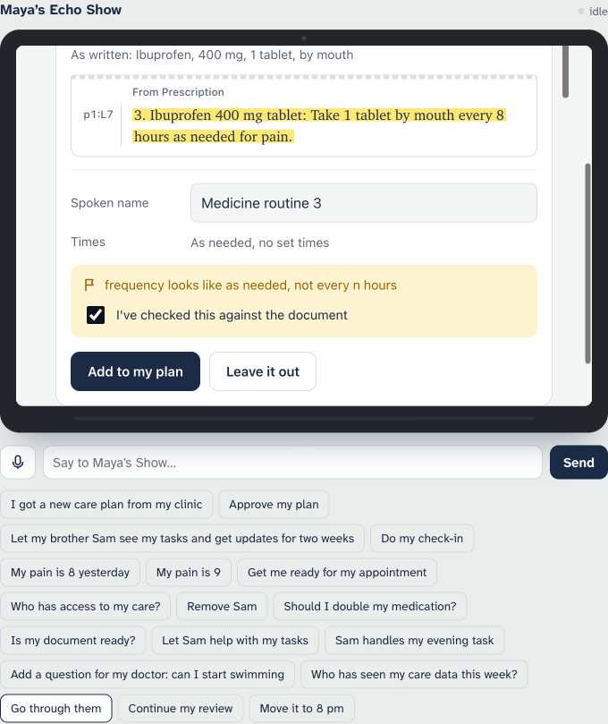
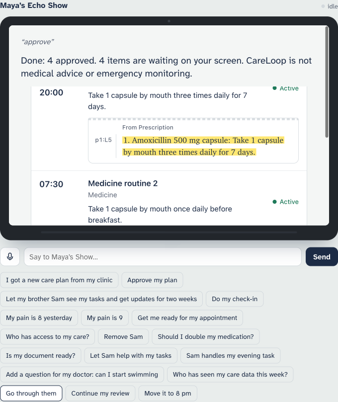
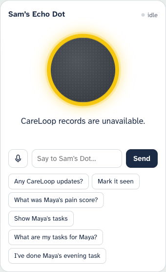
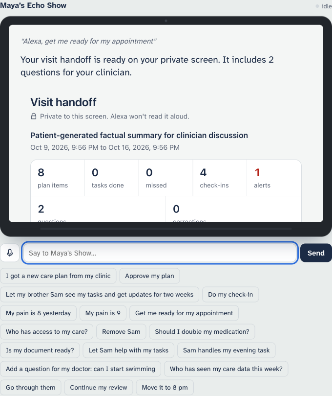
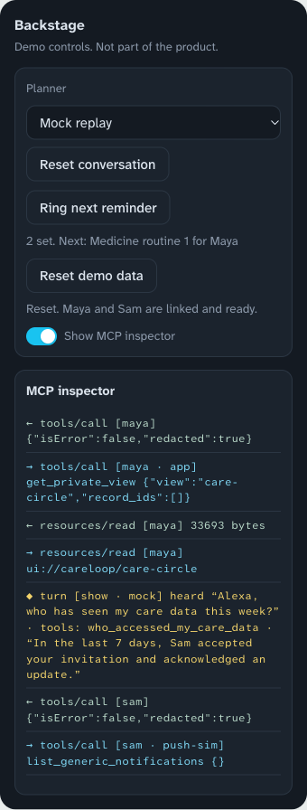

# Using the simulator UI: a click-by-click demo guide

Exactly what to click, type and say, what you should see, and why. Steps 1 to 11 and 13 were driven in a real browser (Chrome, 1440 × 900) against a live server, with the **Mock replay** planner and the local model reading the document. Step 12 (removing Sam) was checked through the same simulator, not by clicking. All data is synthetic.

For a description of every control, see [CARELOOP_UI_GUIDE.md](CARELOOP_UI_GUIDE.md). The full tables of expected replies are in [CARELOOP_DEMO_WALKTHROUGH.md](CARELOOP_DEMO_WALKTHROUGH.md). For the ideas behind each step, see [CARELOOP_SIMULATOR_WALKTHROUGH.md](CARELOOP_SIMULATOR_WALKTHROUGH.md).

---

## 1. Start it and open the page

```bash
CARELOOP_AGENT_LLM=mock scripts/run_alexa_demo.sh --reset
```

The last line it prints is the address to open, for example `http://127.0.0.1:8022`. If port 8021 is taken, the script moves up by one, so always use the printed address.

Open it in Chrome and make the window about 1440 × 900. You should see this:



| Area | Where | What it is |
| --- | --- | --- |
| **Maya's Echo Show** | Left, large | The patient's device with a screen |
| **Sam's Echo Dot** | Middle | The family member's voice-only speaker |
| **Alexa app** | Right, top | Links accounts, opens the invitation, shares documents |
| **Backstage** | Right, below the app | Planner, reset buttons, reminders, and the MCP inspector |

At this point **both accounts are unlinked**. The buttons next to Maya and Sam say **Enable CareLoop**.

---

## 2. Rules for interacting with it

These small things cause most confusion.

1. **Link before you talk.** A device only answers CareLoop requests after its account is linked. The quickest way is **Reset demo data** (below).
2. **Reset demo data needs two clicks.** Click it once and the label changes to **Click again to reset** for about 4 seconds. Click again and it resets, links Maya and Sam, and says "Reset. Maya and Sam are linked and ready."
3. **The Show's screen scrolls inside itself.** Private views open inside the Show's screen, which is only about 400 pixels high. Scroll *inside the screen* to see more. Scrolling the page does not move it.
4. **Wait for the state label to settle.** The word in the top right of each device is `idle`, `listening`, `thinking` or `speaking`. After a question, the Show shows `listening` because its microphone has reopened. You can still just type the answer.
5. **Three ways to give input.** Click a **prompt chip** under a device (fastest and most reliable), type in the box and press **Send**, or press the microphone. Chips say exactly what is written on them.
6. **Say or type "Alexa, …" for new requests.** Answers to a question the device just asked need no "Alexa".
7. **Typing "stop"** interrupts a spoken reply.

---

## 3. The demo, step by step

Start from the seeded day: Maya has accepted data use, Sam is in her care circle, her pain check-ins for the last three days are 3, 4 and 7, and one question for her clinician is saved. Her prescription is not loaded.

### Step 1: Reset and link both accounts

| Do | You should see |
| --- | --- |
| In **Backstage**, click **Reset demo data** | The button changes to **Click again to reset** |
| Click it again | Both **Enable CareLoop** buttons become **Unlink**, and the note says "Reset. Maya and Sam are linked and ready." |
| Check **Planner** | **Mock replay**, so the voice replies are exactly as in this guide |

If you press **Enable CareLoop** for one account yourself, the inspector shows "linked · N model-visible tools discovered".

### Step 2: Share the prescription from the Alexa app

| Do | You should see |
| --- | --- |
| In the **Alexa app** panel, under **Share a document with CareLoop**, leave **From** as Maya and **Type** as Prescription | |
| Under **or use a sample**, choose **Typed PDF** | |
| Click **Share sample** | The status line says "Sending…", then "Ready for Maya to review." after about 10 to 30 seconds |

When it finishes, the Show says: **"Your document is ready. 8 items need your approval, and 2 are flagged for a closer look. Medicine items are approved on your screen. Want to go through them now?"** The plan review screen opens inside the Show:



Why it matters: every item is a draft with its source line, and nothing is active yet. The exact counts can differ a little between runs, because a local model reads the document.

### Step 3: Approve the easy items by voice

Type each line in the **Show's** box, or click the chip (for the first one, **Go through them**).

| Say or type | You should hear and see |
| --- | --- |
| "Go through them" | "Item 1 of 4: Take a short walk every morning, at 8 AM. Approve, change the time, give it to someone, skip, or stop?" |
| "make it 9" | The walk moves to 9 AM and the next item is read: "Item 2 of 4: Change the wound dressing every evening, at 7 PM…" |
| "give it to Sam" | Item 2 is given to Sam, then "Item 3 of 4: Seek emergency care if you have a fever above 39 C…" |
| "approve" | "Item 4 of 4: Follow-up appointment on 2026-10-24 at Riverside Family Clinic…" |
| "approve" | "Done: 4 approved. 4 items are waiting on your screen." |

Why it matters: voice approves only the safe items. The 4 that remain are medicines and flagged items, which have to be approved on the screen.

### Step 4: Approve the medicines on the screen

Scroll *inside the Show's screen* so the cards are visible. For each of the 4 remaining cards:

| Card | Do |
| --- | --- |
| **Medicine routine 1** (Amoxicillin) | Click **Add to my plan** |
| **Medicine routine 2** (Omeprazole) | Click **Add to my plan** |
| **Medicine routine 3** (Ibuprofen) | It is flagged: "frequency looks like as needed, not every n hours". **Add to my plan** is greyed out. Tick **I've checked this against the document**, then click **Add to my plan** |
| **Pain escalation warning** (the alert rule) | It is flagged: "confirm this alert rule matches your clinician's words". Tick the box, then click **Add to my plan** |



Each card shows the medicine as written and the exact line it came from (for example `p1:L7`). **Leave it out** rejects an item. You can also edit the **Spoken name** or **Times** before approving.

When the last card is approved, the "items to check" heading disappears and the screen lists all 8 items as part of your plan:



### Step 5: Ring the reminders

| Do | You should see |
| --- | --- |
| In **Backstage**, click **Ring next reminder** | The Show says "Reminder: Morning activity." |
| Click it again | Sam's Dot caption says "Reminder for Sam: Maya's Evening dressing change." |

The text beside the button counts reminders left and names the next one. These simulate what Alexa+ would create natively.

### Step 6: The privacy moment on Sam's Dot

| Do | You should see |
| --- | --- |
| Under **Sam's Echo Dot**, click **What was Maya's pain score?** | The caption says "CareLoop records are unavailable." No value is shown or spoken |

This is the key privacy point: a family member's shared speaker never hears the symptom.

### Step 7: A high pain score lights Sam's ring

| Do | You should see |
| --- | --- |
| On the Show, type "Alexa, my pain is 8 today" and press **Send** | "Check-in recorded." |
| Look at Sam's Dot | **A yellow ring.** Yesterday was 7 and today is 8, so the approved rule fires |



### Step 8: Sam hears only that an update exists

| Do | You should see |
| --- | --- |
| On the Dot, click **Any CareLoop updates?** | "You have 1 new CareLoop update." |
| Click **Mark it seen** | "CareLoop update acknowledged." The ring goes back to grey |

### Step 9: The medical-advice boundary

| Do | You should see |
| --- | --- |
| On the Show, type "Alexa, should I double my ibuprofen?" | "I can't give medical advice. Please contact your clinician, or emergency services in an emergency." |

In the inspector this turn shows no tool call.

### Step 10: Save a question and prepare the handoff

| Do | You should see |
| --- | --- |
| Type "Alexa, add a question for my doctor: can I shower with the dressing on" | "Saved. You have 2 questions ready for your next appointment." |
| Click **Get me ready for my appointment** | "Your visit handoff is ready on your private screen. It includes 2 questions for your clinician." |



The handoff opens in the Show's screen with totals (plan items, tasks done, missed, check-ins, alerts, questions, corrections). Scroll inside the screen to see the questions, plan items with their source lines, check-ins and the alert.

### Step 11: Who has seen the data

| Do | You should see |
| --- | --- |
| Type "Alexa, who has seen my care data this week?" | "In the last 7 days, Sam accepted your invitation and acknowledged an update." The **Care circle** screen opens with "People with access" and "Who looked at your care data" |

### Step 12 (optional): Remove Sam

| Do | You should see |
| --- | --- |
| Click **Remove Sam** | "This will remove this caregiver's CareLoop access. Say confirm to continue, or cancel." |
| Type "confirm" | "Caregiver access revoked. It stops on their next request." |
| On the Dot, click **Any CareLoop updates?** | "You don't have access to the patient's CareLoop right now…" |

### Step 13: Show the proof in the inspector

The **MCP inspector** is in Backstage, below the buttons. Newest lines are first.



| Line starts with | Meaning |
| --- | --- |
| `→` | A request sent to the CareLoop server, with its arguments |
| `←` | The server's reply. Private values appear as `redacted` |
| `◆ turn` | One finished request: what was heard, which tools ran, what was spoken |
| `[maya · app]` | An action taken from a button on the private screen |
| `[sam · push-sim]` | The simulator checking Sam's updates in the background |

Untick **Show MCP inspector** to hide it for a clean recording.

---

## 4. If something goes wrong

| Problem | Do this |
| --- | --- |
| A device says "Please enable CareLoop for this device…" | Click **Enable CareLoop** for that person, or do step 1 |
| The wrong state | **Reset demo data** (two clicks) |
| A half-finished question swallows your next phrase | Click **Reset conversation** in Backstage |
| The document never finishes | The status line shows an error. The local model may be off, so start Ollama, or start the demo with `CARELOOP_INTAKE_LLM=none` for pattern matching |
| An item count differs from this guide | Normal: a language model reads the document |
| You can't see the Show | Scroll the page to the top, or zoom out with Cmd and minus |
| The Show's cards are cut off | Scroll *inside* the Show's screen, not the page |
| The voice reply sounds different | You are on **Local LLM (Ollama)**. Switch **Planner** to **Mock replay** for exact wording |

## 5. Quick checklist before recording

- [ ] Window about 1440 × 900, page scrolled to the top
- [ ] Both accounts show **Unlink** (linked)
- [ ] **Planner** is the one you want, and **Show MCP inspector** is set as you want it
- [ ] Ollama is running if you will share a document
- [ ] A fresh **Reset demo data** on the day you record, because the pain check-in dates are relative to the reset
